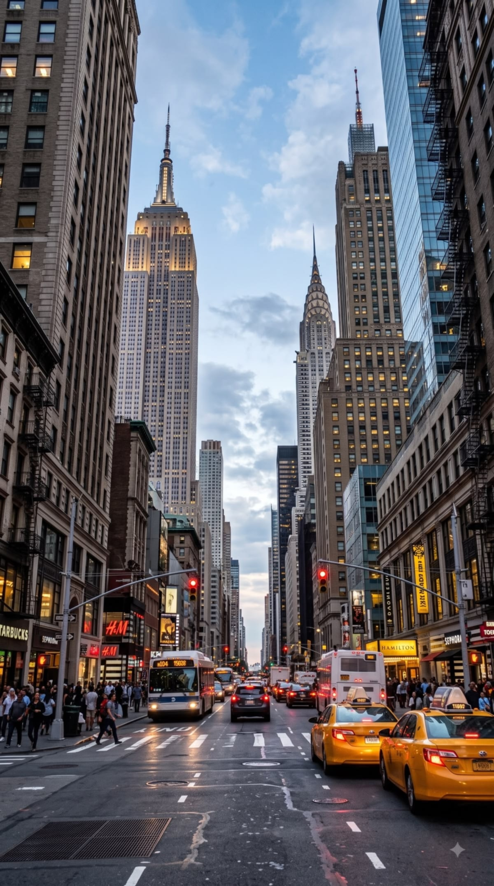

# Gaussian Smoothing

## Overview

Gaussian smoothing (also called Gaussian blur) reduces fine detail and noise in
an image. It replaces each pixel with a weighted average of nearby pixels.
Nearby pixels contribute most to the average, and pixels farther away
contribute less, according to a Gaussian-shaped weighting function.

## What is it used for?

Smoothing is commonly used to:

- reduce sensor noise and small texture before further image processing
- prepare images for edge detection, including the Canny and Hough examples
- soften details when only larger shapes or structures matter
- compare how different blur strengths affect an image

Blurring also removes detail. If the blur is too strong, it can soften
important edges and small features, so choose its strength for the task.

## How the kernel size affects the result

The **kernel** is the neighborhood of pixels used to calculate each weighted
average. This example uses square kernels from `3x3` through `11x11`. Larger
kernels usually produce stronger smoothing because each output pixel uses a
larger neighborhood.

The script calls `cv2.GaussianBlur(image, (k, k), 0)`. The first tuple sets the
kernel width and height; `0` asks OpenCV to derive the Gaussian standard
deviation from the kernel size. Kernel dimensions must be positive odd numbers.

## Run this example

From the repository root:

```powershell
python topics\gaussian-smoothing\gaussian_smoothing.py --no-display
```

The script reads `city.jpeg` from this folder and saves:

- `blur_3x3.jpg`
- `blur_5x5.jpg`
- `blur_7x7.jpg`
- `blur_9x9.jpg`
- `blur_11x11.jpg`

Omit `--no-display` to open the original and all five blurred images in
OpenCV windows. Press a key while a window is active to close them.

## Example results

**Original image**


**Small kernel (`3x3`)**



**Larger kernel (`11x11`)**


