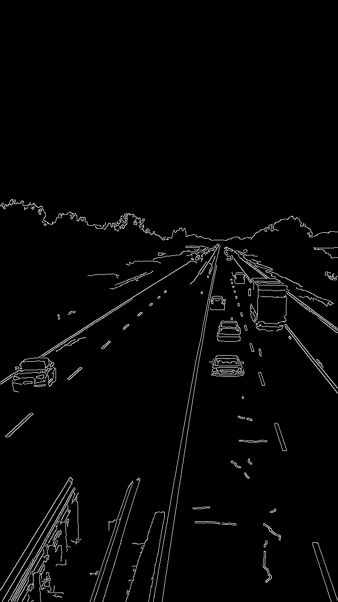
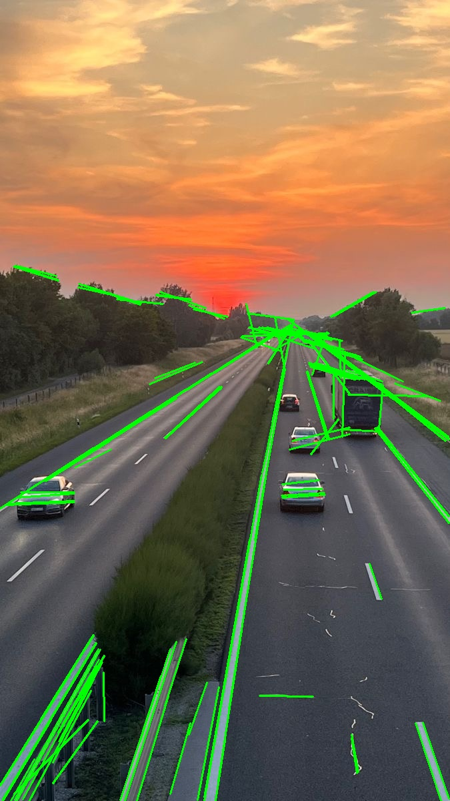

# Hough Line Detection

## Overview

The Hough transform is a method for finding geometric shapes by collecting
evidence from image points. This example uses OpenCV's **probabilistic Hough
line transform** (`cv2.HoughLinesP`) to find finite line segments in an image.
It draws the detected segments in green over the original road image.

## What is it used for?

Line detection is useful when straight structures matter. Typical applications
include:

- estimating lane-marking or road-boundary segments
- finding walls, borders, and edges in buildings or rooms
- detecting table lines, page borders, or other document structure
- measuring the orientation and position of straight features

The transform detects likely straight segments; it does not understand what
they represent. A detected line is not automatically a lane, road boundary,
or object.

## How it works

The transform considers edge pixels as possible contributors to lines. Each
edge pixel votes for lines that could pass through it in a parameter space.
Lines receiving enough votes are returned as detections. The probabilistic
variant used here returns line segments with endpoint coordinates rather than
only infinite lines.

This example first converts the road photo to grayscale, applies a Gaussian
blur to reduce small-scale noise, and runs Canny edge detection. It then passes
the resulting edge map to `cv2.HoughLinesP` and draws any returned segments.
This illustrates how the two topics work together: **Canny finds edge pixels;
the Hough transform groups those pixels into straight-line segments.**

### Parameters in this example

The call uses `rho=1`, `theta=np.pi / 180`, `threshold=50`,
`minLineLength=50`, and `maxLineGap=20`:

- **`rho`** sets the distance resolution of the Hough accumulator, in pixels.
- **`theta`** sets its angle resolution, in radians; `np.pi / 180` is one degree.
- **`threshold`** is the minimum number of votes needed to accept a line.
- **`minLineLength`** discards detected segments shorter than 50 pixels.
- **`maxLineGap`** allows nearby pieces to be joined when the gap is at most
  20 pixels.

These are starting values for the sample image, not universal settings.
Changing image size, noise, contrast, or scene content can require tuning them.
The result may contain missed lines or extra segments, especially in
textured scenes.

## Run this example

From the repository root:

```powershell
python topics\hough-line-detection\hough_transform.py --no-display
```

The script reads `road.jpeg` from this folder and saves:

- `hough_edges.jpg` — the Canny edge map used as input to line detection
- `hough_result.jpg` — the original image with detected segments drawn on it

Omit `--no-display` to open both result images in OpenCV windows. Press a key
while a window is active to close them.

## Example output

**Canny edge map**



**Detected line segments**


