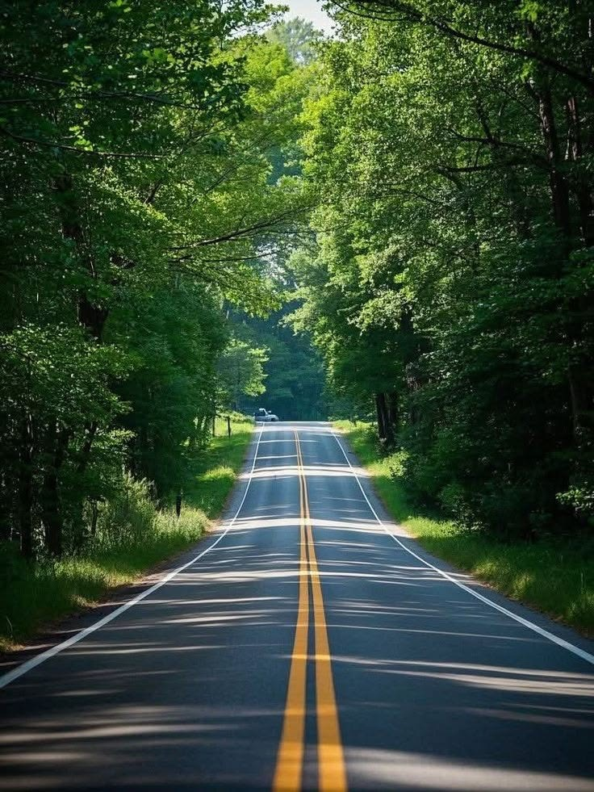
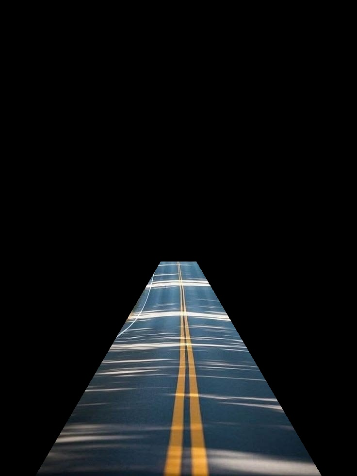
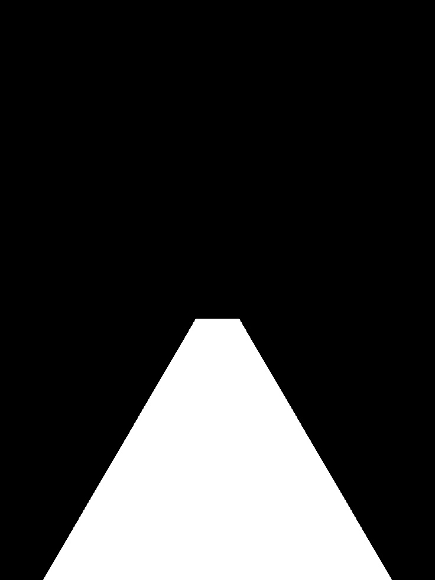

# Region of Interest

## Overview

A **region of interest (ROI)** is the part of an image selected for closer
processing. Restricting work to a useful area can reduce irrelevant image
content and help later computer-vision steps focus on what matters.

This example uses a binary mask to select a polygon-shaped area covering the
road in `nature.jpeg`. Pixels inside the mask keep their original color;
pixels outside it become black.

## What is it used for?

Selecting an ROI is useful when only part of an image matters. Examples include:

- focusing lane detection on the road rather than trees or buildings
- analyzing a specific object or area in an inspection image
- limiting edge detection, thresholding, or measurement to a chosen area
- reducing distractions and unnecessary processing outside the target region

An ROI mask only selects pixels; it does not recognize objects or determine
the correct area automatically. The polygon must be chosen to fit the image
and task.

## How this example works

1. Load the road image and read its width and height.
2. Create a black, single-channel mask with the same dimensions.
3. Define a four-point polygon using coordinates relative to the image size.
4. Fill that polygon in white on the mask.
5. Apply the mask with `cv2.bitwise_and` to keep the selected road region.

The polygon starts near the bottom corners and narrows toward the center of
the image. Its coordinates are based on image width and height, so the shape
scales when the input image dimensions change.

## Run this example

From the repository root:

```powershell
python topics\region-of-interest\region_of_interest.py --no-display
```

The script reads `nature.jpeg` from this folder and saves:

- `roi_mask.jpg` — the white selected polygon on a black background
- `road_roi.jpg` — the original image visible only inside the selected region

Omit `--no-display` to open the original, mask, and selected region in OpenCV
windows. Press a key while a window is active to close them.

## Example results

**Input image**



**Selected road area**



**Mask**


