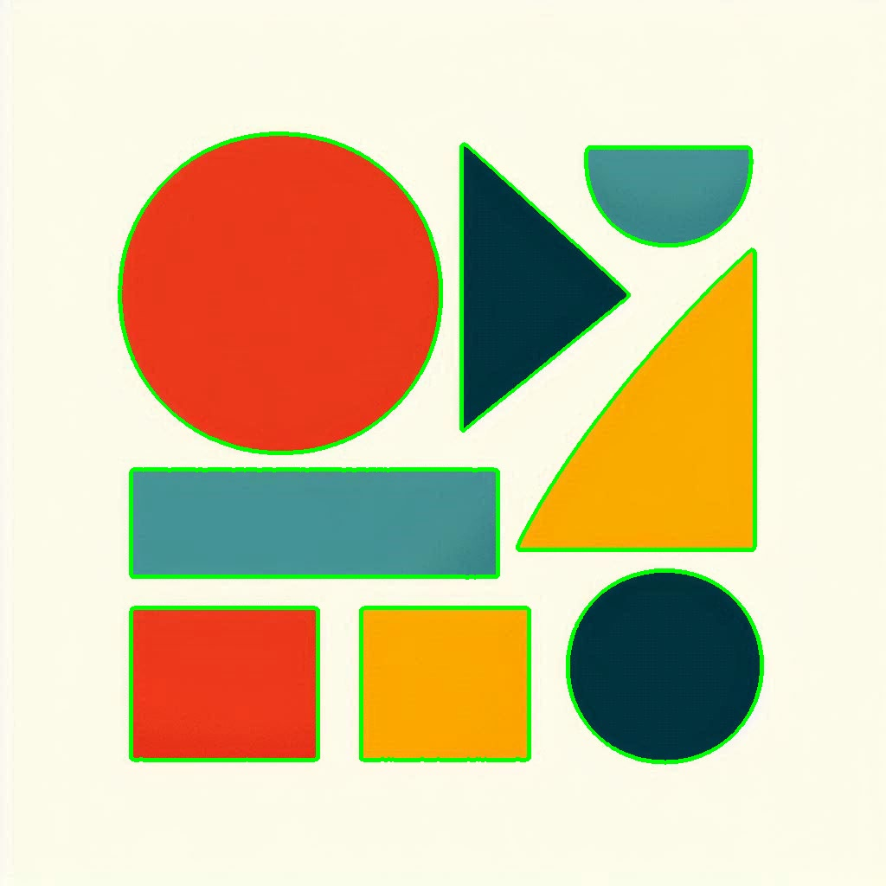

# Shape Recognition

## Overview

This example finds the outlines of shapes in an image using edge detection and
contours. A **contour** is a curve that joins points along the boundary of a
region. OpenCV's `findContours` finds these boundaries, and the example draws
them in green over the original image.

Here, “shape recognition” means detecting and outlining the visible shapes.
The script does **not** classify them as circles, triangles, or rectangles, or
recognize what objects they represent.

## What is it used for?

Contour detection is useful for:

- finding object boundaries in a simple or high-contrast image
- measuring object area, perimeter, and approximate size
- separating shapes for later classification
- locating connected regions in inspection and document images

The quality of the contours depends on image contrast, noise, and the edge
detection settings. Real images may need additional thresholding or contour
filtering to avoid unwanted boundaries.

## How this example works

1. Load `different_shapes.jpeg` and convert it to grayscale.
2. Apply a Gaussian blur to reduce small image variations.
3. Use Canny edge detection to create a binary edge map.
4. Find external contours with `cv2.findContours`.
5. Draw the detected contours in green on a copy of the original image.

The example uses `cv2.RETR_EXTERNAL`, so it retrieves only the outermost
contours, and `cv2.CHAIN_APPROX_SIMPLE`, which stores a compact representation
of each contour.

## Run this example

From the repository root:

```powershell
python topics\shape-recognition\shape_recognition.py --no-display
```

The script reads `different_shapes.jpeg` from this folder and saves:

- `shape_edges.jpg` — the Canny edge map
- `detected_shapes.jpg` — the original image with detected contours drawn on it

Omit `--no-display` to open the original, edge map, and contour result in
OpenCV windows. Press a key while a window is active to close them.

## Example results

**Input shapes**


**Detected contours**



**Canny edge map**


